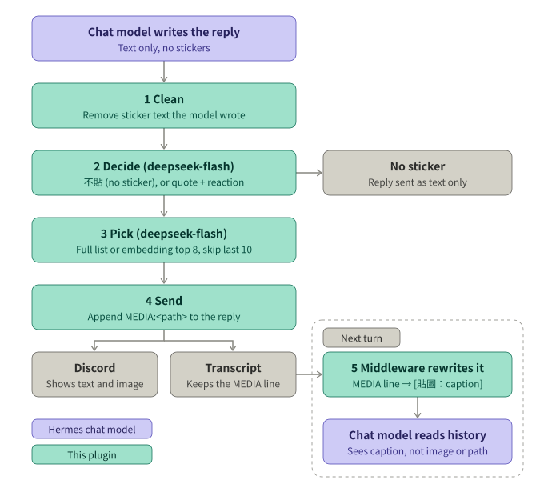

# dafeiyu-companion

**English** | [繁體中文](README.zh-TW.md)

Companion features for a Hermes chat bot that plays 大肥魚 (Dafeiyu, a tsundere, food-loving AI
fish) on Discord.

| Feature | What it does | Switch |
|---|---|---|
| [Reaction stickers](#reaction-stickers) | Before each reply is sent, deepseek-flash decides whether 大肥魚 would react and picks one of 469 captioned stickers. | `memes` |
| [Meme wiki](#meme-wiki) | Adds the wiki entry to the turn when the user asks about a meme. The chat model can also look words up with the `search_meme_wiki` tool. | `memewiki` |
| [Joke seeds](#joke-seeds) | Offers the chat model 2–3 jokes per turn. | `jokes` |
| [Persona reminder](#persona-reminder) | Adds one line per turn that keeps the persona's tone. | always on |

Users can turn each feature on or off in chat ("關掉表情包"); the chat model then calls the
`companion_switch` tool. All features act only on the platforms listed in the
[configuration](#configuration) (Discord by default).

## Reaction stickers



1. **Clean.** Sticker notes, `[[meme:…]]` markers and sticker `MEDIA:` lines that the chat model
   wrote itself are removed from the reply.
2. **Decide.** deepseek-flash reads this turn's user message and the reply. It answers `不貼`
   (no sticker), or quotes the reply's most emotional sentence and names the reaction it shows
   in 15 characters or fewer, for example `被打臉、自嘲吃癟` (proven wrong, laughing at itself).
3. **Pick.** deepseek-flash picks one image for that sentence and reaction. The last 10 stickers
   sent, across all sessions, are excluded.
   - **Full list** (default): all captions are in the system prompt, so the prompt cache covers
     almost all of it. If the model picks a recent sticker anyway, or the call fails, a random
     unused image is sent.
   - **Embedding** (set `meme_embed_url`): only the 8 captions closest to the reaction are
     offered. If the call fails, the closest one is sent.
4. **Send.** `MEDIA:<absolute path>` is appended to the reply, and Hermes's Discord adapter
   uploads the file. GIFs play inline.
5. **Next turn.** The chat model sees each earlier sticker as its caption, for example
   `[貼圖：張嘴輕咬一口，表情俏皮；適合：開玩笑假裝要咬人時]`, so it can refer to the sticker
   it sent.

If the decision or the pick fails or times out, the reply is sent without a sticker and the error
is logged.

### Accuracy and cost

Measured offline on real 大肥魚 Discord replies.

**Which sticker.** For 60 replies that had a sticker, Claude Sonnet scored each mode's pick 1–5
for fit, blind to the mode. It read the captions, not the images.

| Mode | Mean score | Scored ≥4 | Scored ≤2 |
|---|---|---|---|
| Full list | 2.95 | 19/60 | 21/60 |
| Embedding, top 8 | 2.73 | 13/60 | 26/60 |

**Whether to post.** Of 109 replies, Sonnet labelled 14 as should post and 64 as should not. In
each of two runs, the decision posted on 12 of the 14 and on 10 of the 64.

**Cost** at deepseek-flash prices (USD per million tokens: 0.15 input, 0.003 cached input,
0.6 output):

| Step | Cost (USD) | Prompt tokens from cache | Latency, median / max |
|---|---|---|---|
| Decide, every reply | 0.000186 | 54% | 1.8 / 9.6 s |
| Pick, full list, per sticker | 0.000285 | 97% | 2.4 / 8.8 s |
| Pick, full list, per sticker, API without a cache | ≈0.0020 | 0% | — |
| Pick, embedding top 8, per sticker | 0.000161 | 0% | 1.7 / 4.3 s |

At 30 stickers per 100 replies, that is about USD 0.027 per 100 replies with the full list and
USD 0.023 with embedding (the embedding service not counted).

Use the full list when the API has a prefix cache, as DeepSeek does. Without a cache, or with a
much larger sticker library, use the embedding mode.

## Meme wiki

An offline Chinese internet-meme wiki: 6,696 entries in simplified Chinese. Messages in
Traditional Chinese are converted character by character before matching.

- **Automatic.** The entry is added to the turn when the message asks what a meme is
  (「去碼頭整點薯條是什麼梗」), or when the whole message is one word of 2–10 characters that the
  wiki finds. The added text is a short rule (play along with the meme; explain it only when
  asked) and the entry's usage and meaning: 270–1,040 characters, median 560. Short everyday
  words can match an unrelated entry, for example `hi` matches `hide`.
- **Tool.** The chat model can look up any word with `search_meme_wiki`.

## Joke seeds

On a turn without a wiki entry, 2–3 of 24 jokes are picked at random, each with a note on when it
fits, for example `急了（對方被戳到跳腳、開始連珠炮時）`. The chat model is told to use at most
one, not to explain it, and not to joke when the user is sad. This adds 110–160 characters.

## Persona reminder

Every turn ends with 「【語氣】照大肥魚人設說話：傲嬌、口癖、偶爾犯蠢，內容照常準確。」
In long sessions with many tool calls, this keeps the tone set by the persona file.

## Requirements

- Hermes Agent v0.22.5 or later. Tested on v0.22.5 and v0.23.1.
- For stickers: a DeepSeek API key with access to `deepseek-flash`, as `DEEPSEEK_API_KEY`.
- Optional, for the embedding pick: a [Text Embeddings Inference](https://github.com/huggingface/text-embeddings-inference)
  `/embed` endpoint. Developed with Qwen3-Embedding-8B.
- For `fetch_sources.sh`: bash, curl, unzip, sha256sum and Node.js.

The plugin uses the Python standard library only.

## Setup

1. Install and enable the plugin. The install asks for `DEEPSEEK_API_KEY` and saves it to
   `<HERMES_HOME>/.env`.

   ```bash
   hermes plugins install rayyichen310/dafeiyu-companion
   hermes plugins enable dafeiyu-companion
   ```

2. Add the `dafeiyu_companion` toolset to the platforms that should have the two tools
   (`platform_toolsets` in `config.yaml`).
3. Tell the chat model, in its persona or context file, that stickers are added automatically and
   its replies should be text only.
4. Download the stickers, the meme wiki and the joke seeds (about 320 MB) into
   `<HERMES_HOME>/companion-data/`. The script uses pinned versions and checks SHA-256.

   ```bash
   bash <HERMES_HOME>/plugins/dafeiyu-companion/fetch_sources.sh all
   ```

5. Restart the gateway.

## Configuration

`<HERMES_HOME>/config/companion.json`, read on every turn: changes apply on the next turn. A
missing file means the defaults. If the file cannot be read or has a wrong type, every feature is
off and an error is logged.

```json
{
  "memes": true,
  "memewiki": true,
  "jokes": true,
  "platforms": ["discord"],
  "meme_embed_url": ""
}
```

| Key | Meaning |
|---|---|
| `memes`, `memewiki`, `jokes` | Feature switches. `memewiki` covers the tool too. |
| `platforms` | Platforms the features act on. |
| `meme_embed_url` | Empty: full-list pick. A TEI `/embed` URL: embedding pick. Set without a restart, the first sticker afterwards takes about 10 s longer to build the caption index. |

To change a sticker's caption or leave a sticker out, edit `caption-overrides.json` in the plugin
directory (`"<pack>/<path>": {"tag", "caption"}`; tag `skip` leaves the image out).

## Network, files and privacy

- **DeepSeek API** (`https://api.deepseek.com`), only when `memes` is on: every reply on an
  enabled platform sends this turn's user message (up to 500 characters) and the reply (up to
  2,000). When a sticker is sent, the quoted sentence, the reaction and the captions are sent too.
- **Embedding endpoint**, only when `meme_embed_url` is set: the reaction text and, once per
  startup, all captions.
- **Reads** `DEEPSEEK_API_KEY` through Hermes's secret scope, and `<HERMES_HOME>/companion-data/`.
- **Writes** `<HERMES_HOME>/config/companion.json` (via `companion_switch`) and
  `<HERMES_HOME>/companion-data/recent-stickers.json` (the last 10 stickers).
- No shell commands. The embedding mode starts one short-lived background thread to build the
  caption index.

## Sources and licenses

| Feature | Source | Used as is | Changed here |
|---|---|---|---|
| Stickers | [yyh-001/dsh-meme-packs](https://github.com/yyh-001/dsh-meme-packs), 5 packs | Images | Captions rewritten by Claude Haiku (`caption-overrides.json`). Deciding and picking are this plugin's own. |
| Meme wiki | [thawline/dsh-memewiki](https://github.com/thawline/dsh-memewiki) | Entries, lookup and trigger rules, entry format, rule text | Ported to Python; Traditional Chinese matching added. |
| Traditional → Simplified table | [BYVoid/OpenCC](https://github.com/BYVoid/OpenCC) | Character table, for matching only | — |
| Joke seeds | [Hanson0901/dsh-line-bot](https://github.com/Hanson0901/dsh-line-bot) `lib/jokes.mjs` | 24 jokes and their notes | Instruction rewritten. Of upstream's limits, only "not when the user is sad" is kept; upstream also rules out serious talk and first chats, tells the model to skip jokes that don't fit, and bans belittling, regional, gender, illness and political jokes. |
| Persona reminder | This plugin | — | — |

The plugin code is MIT ([LICENSE](LICENSE)). The sticker packs are fan works for personal,
non-commercial use and may not be redistributed (some are CC BY-NC-SA 4.0), so they are
downloaded, not committed. The meme wiki code is MIT; its entries belong to their authors and
cnmeme.wiki. dsh-line-bot is MIT and OpenCC is Apache-2.0. Pinned versions and checksums:
[docs/data-sources.md](docs/data-sources.md).

## Tests

Run after `fetch_sources.sh`; DeepSeek and the embedding service are faked.

```bash
cd <HERMES_HOME>/plugins/dafeiyu-companion
python3 -I -m unittest discover -s tests -q
```
