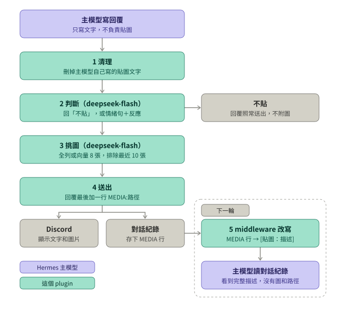

# dafeiyu-companion

[English](README.md) | **繁體中文**

給在 Discord 上扮演大肥魚（一條傲嬌、愛吃的 AI 胖魚）的 Hermes 聊天機器人用的陪聊功能：反應貼圖、
中文網路梗百科、玩梗素材和人設提醒。

主要功能是貼圖。貼圖不由聊天主模型決定：每則回覆送出前，由小模型 deepseek-flash 讀回覆，判斷大肥魚
會不會有反應，再從約 470 張附描述的貼圖裡挑一張。

## 功能

| Hermes 接點 | 行為 |
|---|---|
| `pre_llm_call` hook | 使用者在問某個梗、而且梗百科有收錄時，把那一條加進這一輪；否則加 2～3 則玩梗素材。每輪都加一行人設提醒。 |
| `transform_llm_output` hook | [貼圖流程](#貼圖流程)第 1～4 步：清理回覆、判斷、挑圖、附上貼圖。 |
| `llm_request` middleware | 第 5 步：把先前送出的貼圖以 `[貼圖：<描述>]` 給主模型看。 |
| 工具 `search_meme_wiki` | 在離線梗百科查梗、黑話、縮寫（6,696 條，簡體中文）。 |
| 工具 `companion_switch` | 讓使用者在聊天裡開關各項功能（例如「關掉表情包」）。 |

所有 hook 只在設定檔列出的平台作用（預設只有 Discord）。

## 貼圖流程



1. **清掉主模型自己寫的貼圖**：只該送出下面挑的那張，但主模型在對話紀錄裡會看到先前貼圖的
   `[貼圖：描述]` 註記（第 5 步），可能自己照著寫。回覆裡的這類註記、`[[meme:…]]` 標記和貼圖 `MEDIA:` 行都會刪掉，
   不會變成 Discord 上的一串文字或多一張圖。
2. **判斷**：deepseek-flash 讀這一輪的使用者訊息和回覆，回答「不貼」，或輸出兩行：
   回覆裡情緒最明顯的那一句（原文照抄），以及那一句表現的一種反應（15 字以內，例如「被打臉、自嘲吃癟」）。
3. **挑圖**：deepseek-flash 依那一句和反應挑一張。跨所有 session 最近送出的 10 張不列入。有兩種模式：
   - **全列**（預設）：全部描述以固定順序放在 system prompt，幾乎整段都能吃到 prompt 快取；最近用過的
     編號寫在 user message 裡叫它別選。它仍挑到最近用過的、或呼叫失敗時，改送一張沒用過的隨機圖片。
   - **向量**：設定 `meme_embed_url` 後啟用。把反應轉成向量，只列出描述中「適合：」那段最接近的 8 張；
     呼叫失敗時送最接近的那張。
4. **送出**：在回覆最後加一行 `MEDIA:<絕對路徑>`，由 Hermes 的 Discord adapter 上傳，GIF 直接在 Discord 播放。對話紀錄會存下這行 `MEDIA:`。
5. **下一輪**：`llm_request` middleware 把對話紀錄裡的每一行貼圖改成 `[貼圖：完整描述]` 給主模型看，例如
   `[貼圖：張嘴輕咬一口，表情俏皮；適合：開玩笑假裝要咬人時]`。主模型知道自己貼過哪張、可以接著聊，但看不到圖片本身和路徑。

判斷或 embedding 查詢失敗、逾時時，回覆照常送出、不附貼圖，錯誤寫進 log。各步驟的逾時加起來在
Hermes plugin hook 的 30 秒上限內。

## 準確度與成本

以下是用大肥魚真實的 Discord 回覆離線量測的結果，價格用 deepseek-flash（每百萬 token 美元：輸入 0.15、
命中快取的輸入 0.003、輸出 0.6）。

**準確度**：樣本是 60 則線上有貼圖的回覆。每則回覆把兩種模式挑出的圖片描述混在其他候選裡、打亂順序交給
Claude Sonnet，不告訴它來源，依搭配程度評 1～5 分。評審讀的是描述文字，沒有看圖片。

| 模式 | 平均分 | 4 分以上 | 2 分以下 |
|---|---|---|---|
| 全列 | 2.95 | 19/60 | 21/60 |
| 向量取 8 張 | 2.73 | 13/60 | 26/60 |

**該不該貼**：樣本是 109 則 Discord 回覆，Sonnet 標註該貼 14 則、可貼可不貼 31 則、不該貼 64 則。判斷跑兩次，
每次都在該貼的 14 則裡貼了 12 則，在不該貼的 64 則裡貼了 10 則。

**成本（含快取）**：判斷每則回覆都要跑；挑圖只在要貼時跑。

| 步驟 | 費用（美元） | prompt token 命中快取的比例 | 回應時間（中位數／最慢） |
|---|---|---|---|
| 判斷，每則回覆 | 0.000186 | 54% | 1.8／9.6 秒 |
| 挑圖，全列，每張貼圖 | 0.000285 | 97% | 2.4／8.8 秒 |
| 挑圖，全列，每張貼圖，假設 API 沒有快取 | 約 0.0020 | 0% | — |
| 挑圖，向量取 8 張，每張貼圖 | 0.000161 | 0% | 1.7／4.3 秒 |

假設每 100 則回覆貼 30 張，判斷＋全列約 0.027 美元，判斷＋向量約 0.023 美元（不含 embedding 服務本身）。
全列的 system prompt 約 12,000 token；快取過期後（閒置數小時），下一次挑圖要重新寫入，那一次約 0.0018 美元。

**建議**：

- API 支援 prefix 快取（例如 DeepSeek）：用全列，最準。
- API 沒有快取：全列每張貼圖貴約 7 倍；有 embedding 服務就用向量模式。
- 圖庫大很多時：全列的 prompt 會跟著變長，向量模式不受影響。

## 需求

- 有上述 plugin hook 的 Hermes Agent（開發時用 v0.22.5）。
- 能用 `deepseek-flash` 的 DeepSeek API key，設為 `DEEPSEEK_API_KEY`，經由 Hermes 讀取（profile 的 `.env`
  或環境變數）。模型和 endpoint 寫死在 `meme_marker.py`。
- 選用，向量模式才需要：[Text Embeddings Inference](https://github.com/huggingface/text-embeddings-inference)
  的 `/embed` endpoint。開發時用 Qwen3-Embedding-8B。
- 只用 Python 標準函式庫，不需另外安裝套件。
- 執行 `fetch_sources.sh` 需要 bash、curl、unzip、sha256sum 和 Node.js（只用來取出玩梗素材）。

## 安裝

1. 安裝並啟用 plugin。安裝時會詢問 `DEEPSEEK_API_KEY`，存進 `<HERMES_HOME>/.env`。

   ```bash
   hermes plugins install rayyichen310/dafeiyu-companion
   hermes plugins enable dafeiyu-companion
   ```

   不用 CLI 的話：把這個 repo clone 到 `<HERMES_HOME>/plugins/dafeiyu-companion/`，並在 `config.yaml` 的
   `plugins.enabled` 加上 `dafeiyu-companion`。
2. 在 `config.yaml` 的 `platform_toolsets` 裡，替要用這兩個工具的平台加上 `dafeiyu_companion` toolset。
3. 在主模型的人設或規則檔寫明「貼圖由系統自動附加，回覆只寫文字」；這個 plugin 不會自己加這條指示。
4. 下載圖片、梗百科等資料（約 320 MB）到 `<HERMES_HOME>/companion-data/`。腳本用釘選版本並驗證 SHA-256：

   ```bash
   bash <HERMES_HOME>/plugins/dafeiyu-companion/fetch_sources.sh all
   ```

5. 重啟 gateway。

## 設定

設定檔是 `<HERMES_HOME>/config/companion.json`，每輪讀取，改了下一輪就生效，不用重啟。沒有這個檔案就用預設值；
檔案讀不了或型別錯誤時，所有功能關閉並寫一筆錯誤 log。

| 欄位 | 預設 | 意思 |
|---|---|---|
| `memes` | `true` | 貼圖 |
| `memewiki` | `true` | 梗百科注入和 `search_meme_wiki` 工具 |
| `jokes` | `true` | 玩梗素材 |
| `jokes_wanjiqi` | `false` | 玩梗素材加入較重口味的 wanjiqi 來源 |
| `platforms` | `["discord"]` | hook 作用的平台 |
| `meme_embed_url` | `""` | 空字串：全列挑圖。填 TEI `/embed` 網址：向量挑圖。不重啟的話，設定後第一張貼圖要順便建向量索引（約 10 秒）；重啟則在啟動時建好。 |

```json
{
  "memes": true,
  "memewiki": true,
  "jokes": true,
  "jokes_wanjiqi": false,
  "platforms": ["discord"],
  "meme_embed_url": ""
}
```

### 資料檔

- `caption-overrides.json`（在這個 plugin 資料夾）：每張圖的描述和分類（`"<圖庫>/<路徑>": {"tag", "caption"}`），
  一律取代上游 `index.db` 裡的描述和分類，`index.db` 保持下載時的原樣。分類填 `skip` 會排除該圖。
  描述由 Claude Haiku 重寫，格式是「畫面；適合：使用情境」。

以下在 `<HERMES_HOME>/companion-data/`，由 `fetch_sources.sh` 和 plugin 寫入：

- `meme-packs/`：5 套貼圖，共 469 張，各套附上游的 `index.db` 和 `manifest.json`。
- `recent-stickers.json`：最近送出的 10 張，由 plugin 寫入。
- `memewiki/memes.db`、`jokes/`、`opencc/`：梗百科、玩梗素材，以及讓繁體訊息能比對簡體梗百科的字表。

## 網路、檔案與隱私

- **DeepSeek API**（`https://api.deepseek.com`）：在啟用的平台上，每則回覆都會送出這一輪的使用者訊息
  （最多 500 字）和回覆（最多 2,000 字）做判斷；要貼圖時再送出那一句、反應和圖片描述做挑圖。
  `memes` 關閉時不送。
- **Embedding 服務**：只在設定 `meme_embed_url` 時使用：送出反應文字，每次啟動另送一次全部描述。
- **讀取**：經由 Hermes 的 secret scope 讀 `DEEPSEEK_API_KEY`，以及 `<HERMES_HOME>/companion-data/`。
- **寫入**：`<HERMES_HOME>/config/companion.json`（經由 `companion_switch`）和
  `<HERMES_HOME>/companion-data/recent-stickers.json`。
- 不執行 shell 指令。向量模式會開一條短暫的背景執行緒建索引。

## 授權

plugin 程式碼是 MIT（[LICENSE](LICENSE)）。

貼圖是同人作品，只供個人非商業使用，不可再散布（部分為 CC BY-NC-SA 4.0），所以圖片用下載的、不進 git。
梗百科程式是 MIT，詞條版權屬原作者與 cnmeme.wiki。各來源、釘選版本與授權見
[docs/data-sources.zh-TW.md](docs/data-sources.zh-TW.md)。

## 測試

```bash
cd <HERMES_HOME>/plugins/dafeiyu-companion
python3 -I -m unittest discover -s tests -q
```

先跑過 `fetch_sources.sh` 再測：測試會讀 `<HERMES_HOME>/companion-data/` 裡的梗百科、玩梗素材和繁簡字表。
DeepSeek 和 embedding 服務以假的代替，不需要網路。
